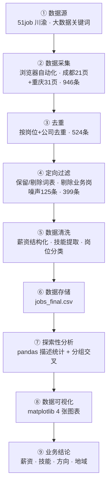

# 大数据岗位招聘数据分析

> 求职作品集项目 ｜ 四川财经职业学院 · 大数据技术专业 · 郭欣月 ｜ 技术栈：Python · requests · bs4 · pandas · matplotlib

[](https://www.python.org/)
[](https://pandas.pydata.org/)
[](https://matplotlib.org/)

## 项目简介

从真实招聘需求出发，以 51job（前程无忧）川渝地区公开岗位数据为样本：采集原始岗位 **946 条 → 去重 524 条 → 定向词表过滤出 399 条大数据相关岗位**，完整走通「数据采集 → 清洗过滤 → 分析 → 可视化」的数据分析闭环，量化分析大数据相关岗位的**薪资分布、技能要求、岗位类型与地域需求**，为大数据专业应届生提供可执行的求职定位参考。

**一句话概括**：用 399 条真实招聘数据，回答「应届生该学什么技能、往哪个方向投、预期多少薪资、去哪个城市」。

## 项目亮点

- **真实数据驱动**：51job 川渝真实在招岗位 399 条（原始 946 条），非模拟数据；
- **按反爬强度选型采集方案**：51job 强反爬用浏览器自动化；sc91 静态页用 requests+bs4；sc91 接口用 requests 直采 JSON——三套实现按需切换；
- **定向词表过滤**：剔除「大数据公司在招会计/销售」类关键词噪声 125 条，保证岗位纯度；
- **技能词频分析**：从岗位标签中量化技能要求 Top 榜，直接回答「该学什么」；
- **合规采集意识**：robots 协议检查、请求限速、只采公开信息、不触碰个人信息。

## 成果预览

| 薪资分布 | 技能要求 | 岗位类型 | 成都各区 |
| --- | --- | --- | --- |
|  |  |  |  |

**核心结论**（详见完整报告）：
1. 薪资：中位 **9000 元/月**，25–75 分位 6500–11500；
2. 技能：**人工智能、数据分析、Java、SQL** 是核心要求，Hadoop/Spark 是大数据方向加分项；
3. 岗位结构：开发工程师 + AI/算法岗合计占 **62%**，数据标注是低门槛入口；
4. 成都各区：岗位集中在**武侯区(32)、高新区(22)、锦江区(19)**，三区合计占已标注岗位的 43%。

## 数据处理流程



## 项目结构

```
.
├── README.md               # 本文件（仓库首页）
├── 求职项目报告.md          # 完整项目报告
├── index.html / report.html # 作品集网页版（图片内嵌）
├── job_crawler_51job.py    # 51job 采集脚本（浏览器自动化）
├── filter_and_clean.py     # 定向过滤 + 清洗脚本
├── job_visualize_final.py  # 可视化脚本
├── job_crawler_requests.py # requests+bs4 采集框架（静态源）
├── jobs_51job.csv          # 原始数据 524 条
├── jobs_final.csv          # 最终数据 399 条
└── salary_dist 等图        # 可视化图表
```

## 快速开始

```bash
# 1. 安装依赖
pip install requests beautifulsoup4 lxml pandas matplotlib

# 2. 采集数据（浏览器自动化，输出 jobs_51job.csv）
python job_crawler_51job.py

# 3. 定向过滤 + 清洗（输出 jobs_final.csv）
python filter_and_clean.py

# 4. 可视化（输出 4 张 PNG 图）
python job_visualize_final.py
```

> 说明：`job_crawler_51job.py` 默认采集成都 + 重庆「大数据」关键词岗位，改搜索 URL 的 `keyword` / `jobArea` 可扩展到其他城市或关键词。

## 数据来源与合规说明

- **主数据源**：51job（前程无忧）川渝「大数据」关键词在招岗位；采集使用浏览器自动化（真实浏览器渲染），遵守网站服务条款，请求间隔限速，仅采集招聘方主动公开的岗位信息（岗位名、薪资、技能标签、公司信息），不采集任何求职者个人信息；
- **辅助数据源**：四川公共招聘网招聘公告（requests+bs4 框架演示）；成都人才网因 robots.txt 明确禁止抓取职位列表页，已主动放弃采集；
- **样本说明**：最终 399 条为关键词「大数据」命中并经定向词表过滤的岗位，与全市场大数据岗位行情存在口径差异；51job 列表页不含学历字段，学历维度分析见局限性说明。

## 完整报告

项目背景、采集方案、清洗过程、EDA 分析、业务结论、局限性与优化方向的完整阐述，见 **[完整项目报告 →](report.html)**。

## 作者

- 四川财经职业学院 · 大数据技术专业（大三）· 郭欣月，独立完成本项目全部环节。

---

*本项目仅用于个人求职作品集展示与学习交流。*
