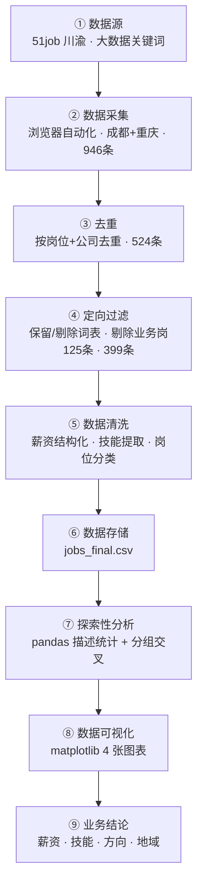
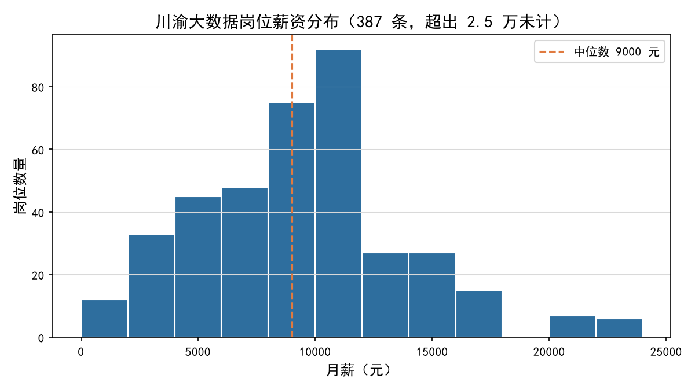
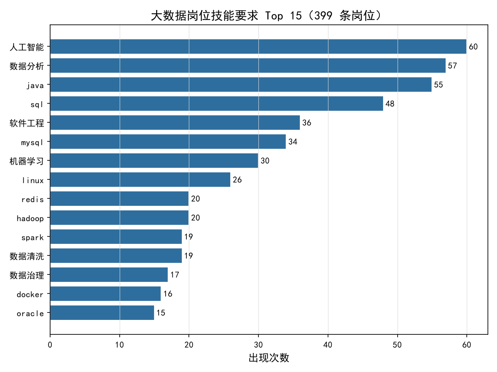
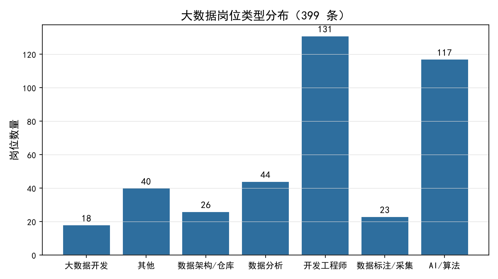
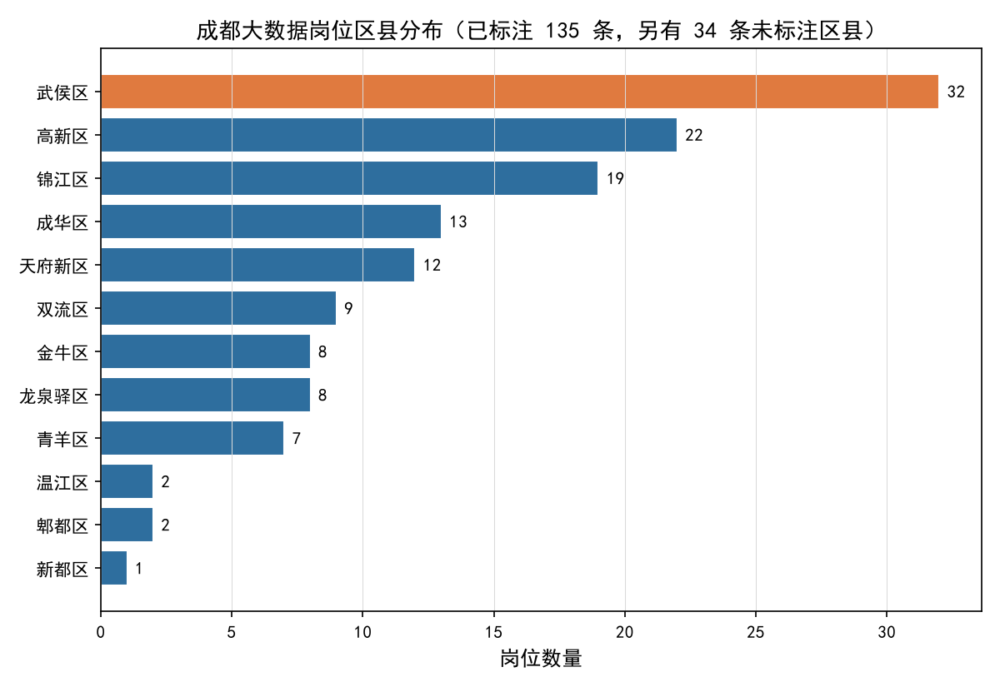

# 大数据岗位招聘数据分析 —— 求职项目报告

> 四川财经职业学院 · 大数据技术专业（大三）· 郭欣月 ｜ 求职项目 ｜ 技术栈：Python / requests / bs4 / pandas / matplotlib

---

## 1. 项目概述

大数据技术人才市场需求旺盛，但院校培养与岗位实际要求之间存在明显信息差。多数应届生求职时缺乏对「岗位真正需要什么技能、薪资大致落在什么区间、哪些城市机会更多」的量化认知，往往凭感觉投递，效率低、错配率高。

本项目以 **51job（前程无忧）川渝地区**公开岗位数据为样本，采集原始岗位 946 条，经去重与定向过滤后得到 **399 条大数据相关岗位**，完整走通「数据采集 → 清洗过滤 → 分析 → 可视化」的数据分析全流程，回答四类核心问题：**薪资水平、技能要求、岗位类型、地域分布**，最终形成面向大数据专业应届生的求职参考结论。

- **项目定位**：以真实招聘数据驱动的「求职定位」分析，而非展示型 demo。
- **我的角色**：独立完成数据采集、清洗、分析与可视化全流程。

---

## 2. 数据源与采集方案

### 2.1 采集方案设计：按反爬强度选型

项目共实现**三套采集方案**，按目标网站的反爬强度与页面形态选型：

| 目标网站 | 页面形态 | 反爬强度 | 采集方案 | 产出 |
| --- | --- | --- | --- | --- |
| 51job（主数据源） | 动态渲染 | 登录态+验证码+动态签名 | 浏览器自动化（Playwright） | 946 条 |
| sc91 四川公共招聘网 | JSON 接口 | 无 | requests 直采接口 | 30 条 |
| sc91 招聘公告 | 静态 HTML | 无 | requests + bs4 | 8 篇 |

> 51job 的岗位数据由前端 JS 调用加密接口渲染，普通 HTTP 请求只能拿到验证页——这一结论经 requests 实测验证后，才决定采用浏览器自动化方案。

### 2.2 采集过程

使用浏览器自动化驱动真实 Chromium，访问 51job 职位搜索页（关键词「大数据」，城市成都 + 重庆），逐页解析职位卡片并翻页采集：

- **成都** 21 页（其中 17 页有效）+ **重庆** 31 页，共采集 **946 条**；
- 每次翻页间隔 2 秒以上限速，仅采集招聘方主动公开的岗位信息，不触碰任何求职者个人信息；
- 按岗位名 + 公司名去重后得 **524 条**。

### 2.3 合规说明

- 遵守 robots 协议：成都人才网 robots.txt 明确禁止抓取职位列表页，**已主动放弃该源**（合规检查真实拦截案例）；
- 只采集公开岗位信息，不采集简历、联系方式等个人信息；
- 数据仅用于个人学习与求职分析，不做商业用途。

---

## 3. 数据预处理与清洗

项目数据处理全流程如下：

### 3.1 定向词表过滤（关键步骤）

「大数据」关键词会命中大量噪声：**大数据公司在招会计、销售、行政**（如「天府流体大数据研究中心招聘总账会计」）。为保证岗位纯度，设计两级词表过滤：

- **保留词表**（40 个）：数据、算法、AI、开发、工程师、Python、Java、数仓、架构、爬虫……
- **剔除词表**（21 个）：会计、出纳、销售、行政、客服、司机、店长……

过滤结果：524 条 → **399 条**，剔除 125 条业务岗噪声（如「总账会计」「电商营运经理」「市场总监」）。

### 3.2 其他清洗

| 问题类型 | 实际问题 | 处理方式 |
| --- | --- | --- |
| 薪资格式混乱 | 「1-2万」「8千-1.2万」「24-30万/年」混杂 | 统一解析为元/月数值区间（年薪折月薪） |
| 标签混合 | 技能词与福利词混在同一字段 | 技能白名单提取（Hadoop/Spark/SQL/Java…68 个技术词） |
| 岗位命名不统一 | 数据分析/AI/开发/标注混杂 | 关键词分类为 7 类岗位类型 |

---

## 4. 探索性数据分析

### 4.1 薪资分布 —— 主流薪资带在哪

直方图：387 条薪资 ≤2.5 万的岗位中，**中位数 9000 元/月**，主峰集中在 8000–12000 元区间。全体分位数：25 分位 6500 元、75 分位 11500 元、90 分位 15001 元。

### 4.2 技能要求 Top 15 —— 该学什么

横向条形图：**人工智能(60)、数据分析(57)、Java(55)、SQL(48)** 是出现频率最高的四项技能；MySQL(34)、机器学习(30)、Linux(26) 紧随其后。值得注意：**Hadoop(20)、Spark(19) 等经典大数据框架仅排中游**——川渝市场的大数据岗更偏「AI 应用 + 数据开发」复合型，大数据框架是专项加分项而非普遍门槛。

### 4.3 岗位类型分布 —— 哪个方向值得冲

柱状图：**开发工程师 131 + AI/算法 117 合计占 62%**，是市场绝对主体；数据分析 44、数据架构/仓库 26、数据标注/采集 23、大数据开发 18。数据标注/采集是低门槛入口，但占比最小、天花板也低。

### 4.4 成都各区分布 —— 机会在哪里

横向条形图：**武侯区 32 岗居首（占已标注岗位的 20%）**，高新区 22、锦江区 19 次之——前三区合计占 43%；成华区 13、天府新区 12 也是机会集中区。另有 34 条岗位未标注区县、2 条地址异常，未计入统计。

---

## 5. 业务结论与项目价值

1. **薪资预期**：中位 **9000 元/月**，25–75 分位 6500–11500。应届生第一份工作的合理预期区间为 **6500–9000 元**（低于 6500 的多为标注/实习岗，高于 1.2 万的占 23% 且多要求经验）。
2. **技能路线**：技能词频给出清晰的学习优先级——**SQL + Java/Python 打底 → 数据分析与机器学习进阶 → Hadoop/Spark 大数据框架专项**。「人工智能」作为技能标签出现 60 次，说明 AI 应用能力已成为大数据岗的高频要求。
3. **方向选择**：开发工程师 + AI/算法岗占 62%，是薪资与机会的主体；数据标注/采集岗是低门槛入场券，但应尽早向开发/分析方向迁移。
4. **地域策略**：成都大数据岗四成以上集中在**武侯、高新、锦江**三区（均为写字楼聚集区）——简历投递与租住选址优先覆盖这三区，同时拿到最多机会与最短通勤。

**项目价值**：对自己，明确了「学什么技能、投什么方向、预期多少薪资、去哪些城市」；对其他应届生，这套「按反爬强度选型采集 → 定向过滤 → 词频分析」的方法论可复用到任何城市、任何岗位品类的求职调研。

---

## 6. 项目总结、局限性与优化方向

### 6.1 项目总结

本项目从真实需求出发，独立完成了一个完整的数据分析闭环：**三套采集方案按反爬强度选型**（浏览器自动化 / requests 直采接口 / requests+bs4 静态解析）→ 去重与定向词表过滤（946 → 524 → 399）→ 薪资结构化与技能提取 → 描述统计与分组交叉分析 → 4 张图表可视化 → 提炼 4 条可执行的求职结论。全程使用 Python 技术栈，代码可复现、结果可溯源。

### 6.2 局限性

| 局限 | 说明 |
| --- | --- |
| 岗位口径 | 仅覆盖关键词「大数据」命中并经词表过滤的岗位，部分数据类岗位（如「BI 工程师」）可能未被关键词覆盖 |
| 学历字段缺失 | 51job 列表页不含学历要求，学历维度分析需进详情页采集补齐 |
| 个别薪资异常 | 存在少量日薪被误解析为月薪的极端值（最低 100 元），中位数统计不受影响 |
| 平台单一 | 仅 51job 一个平台，与全市场行情存在差异 |
| 时效性 | 数据为 2026 年 10 月采集快照，招聘市场变化较快 |

### 6.3 后续优化方向

1. **补齐学历维度**：进详情页采集学历与经验要求，量化「专科生可投岗位占比」；
2. **扩关键词与城市**：增加「数据分析」「ETL」「BI」等关键词，扩展至全国主要城市做横向对比；
3. **技能-薪资关联分析**：量化「掌握某技能平均带来多少薪资溢价」，让学习路线更有依据；
4. **进阶建模**：用机器学习对薪资做预测，输出岗位推荐。

---

### 附 · 简历项目描述（精简版）

基于 Python 采集 51job 川渝地区大数据岗位（浏览器自动化应对强反爬，采集 946 条），经去重与定向词表过滤得 399 条有效样本，完成薪资结构化与技能词频提取（pandas），通过分组统计与可视化（matplotlib）分析岗位薪资分布、技能要求与地域差异，提炼出面向应届生的求职定位结论，并形成可复现的数据分析报告。
